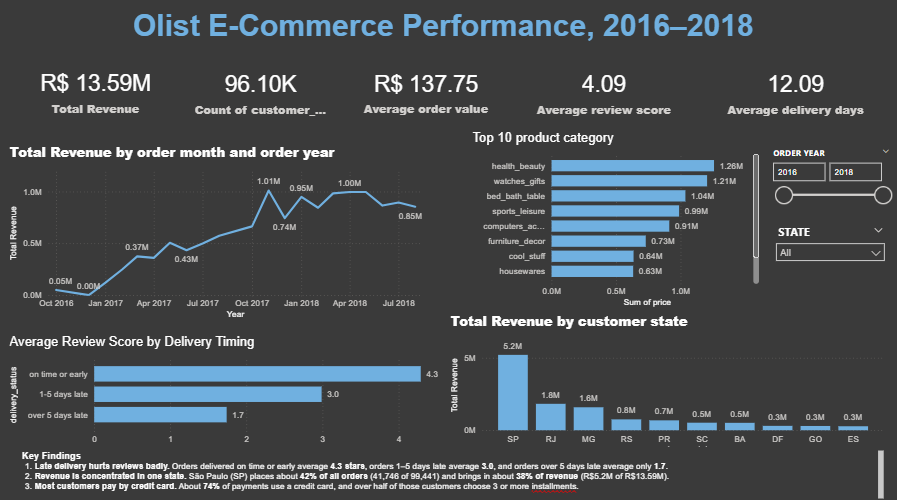

# Retail Business Intelligence: Olist E-Commerce Analytics


A retail business intelligence study analyzing 99,441 Brazilian e-commerce orders from 2016 to 2018 using Python, PostgreSQL, and Power BI. Dataset provided by [Olist on Kaggle](https://www.kaggle.com/datasets/olistbr/brazilian-ecommerce).



---

## Business Questions

- **Delivery Performance and Customer Satisfaction**: How does order delivery timing compare against estimated delivery dates, and how are shipping delays associated with customer review scores?
- **Revenue Trajectory and Seasonality**: What is the trajectory of monthly sales growth, and how do major retail events such as Black Friday impact revenue?
- **Merchandising Performance**: Which product categories generate the highest merchandise revenue (excluding freight), and which drive unit order volumes?
- **Customer Financing and Geography**: What payment methods and installment options do customers utilize, and how concentrated is demand across Brazilian states?

---

## Key Findings

1. **Delivery timing is strongly associated with customer review ratings**: Delivered orders arriving on time or early averaged a review score of 4.3 / 5. Ratings dropped to 3.0 for orders arriving 1–5 days late, and further declined to 1.7 for orders arriving more than 5 days late. The overall fulfillment rate was 97.0% delivered, with an average delivery time of 12.09 days and a late delivery rate of 6.8% 
2. **Order demand and revenue are heavily concentrated in southeastern Brazil**: The state of São Paulo (SP) represents about 42% of all orders (41,746 of 99,441) and about 38% of total revenue (R$5.2M of R$13.59M). The next largest contributing states are Rio de Janeiro (RJ) at R$1.8M and Minas Gerais (MG) at R$1.6M.
3. **Merchandise revenue scaled to R$13.59M with credit-financed purchasing**: Across 96.10K unique customers, average order value was R$137.75. Top categories by product revenue (price, excluding freight) are led by `health_beauty` (R$1.26M), `watches_gifts` (R$1.21M), `bed_bath_table` (R$1.04M), `sports_leisure` (R$0.99M), `computers_accessories` (R$0.91M), `furniture_decor` (R$0.73M), `cool_stuff` (R$0.64M), and `housewares` (R$0.63M). In payment records, about 74% use credit card and about 19% boleto; over half of credit card transactions use 3+ installments. Monthly revenue grew from about R$0.05M in October 2016 to about R$1.0M per month in late 2017/2018, peaking in November 2017 during Black Friday.

---

## Recommendations

- **Set more realistic delivery estimates**: Calibrate carrier transit estimates dynamically for distant states outside southeastern hubs to reduce the frequency of orders exceeding the promised arrival date.
- **Send proactive alerts for orders likely to be late**: Implement milestone tracking and notify customers before their order passes its estimated delivery date to mitigate negative review sentiment.
- **Monitor delayed sellers and states while diversifying regional fulfillment**: Track sellers and regional routes with the highest late delivery rates, and establish regional distribution partnerships to reduce single-point dependency on São Paulo (SP).

---

## Key Performance Indicators

| Metric | Value | Scope / Context |
|---|---|---|
| **Total Revenue** | **R$ 13.59M** | Total sales value across all orders in dataset [ covers all 99,441 orders in orders table; delivered orders total R$ 13.59M] |
| **Unique Customers** | **96.10K** | Distinct count of `customer_unique_id` across transactions |
| **Total Orders** | **99,441** | Total order transactions recorded between 2016 and 2018 |
| **Average Order Value (AOV)** | **R$ 137.75** | Mean revenue per order [ calculated across all orders with item values; delivered orders average R$ 137.75] |
| **Fulfillment Rate** | **97.0%** | Percentage of total orders marked with `order_status = 'delivered'` |
| **Average Delivery Time** | **12.09 days** | Average transit time from purchase timestamp to customer delivery |
| **Late Delivery Rate** | **6.8%** | Orders delivered past the promised estimated date  |
| **Average Review Score** | **4.09 / 5.0** | Overall mean customer satisfaction score across 99K+ reviews |

---

## Data and Methodology

### Relational Schema

The dataset models 9 relational tables centered around customer orders:

```
                  ┌───────────────┐
                  │   CUSTOMERS   │
                  └───────┬───────┘
                          │ 1
                          │
                          │ N
                  ┌───────┴───────┐
                  │    ORDERS     ├──────────────┬──────────────┐
                  └───────┬───────┘              │              │
                          │ 1                    │ 1            │ 1
                          │                      │              │
                          │ N                    │ N            │ N
                  ┌───────┴───────┐      ┌───────┴──────┐┌──────┴───────┐
                  │  ORDER_ITEMS  │      │   PAYMENTS   ││   REVIEWS    │
                  └───────┬───────┘      └──────────────┘└──────────────┘
                          │ N
            ┌─────────────┴─────────────┐
            │ 1                         │ 1
    ┌───────┴───────┐           ┌───────┴───────┐
    │   PRODUCTS    │           │    SELLERS    │
    └───────────────┘           └───────────────┘
```

Column definitions and foreign key constraints are documented in [docs/data_dictionary.md](docs/data_dictionary.md).

### Data Cleaning and Audit

Data cleaning steps implemented in [notebooks/01_data_quality_assessment.ipynb](notebooks/01_data_quality_assessment.ipynb):

- **Data audit**: Calculated row counts, column types, missing values, and duplicate rows across all 9 raw tables and saved the audit summary to [docs/data_quality_report.csv](docs/data_quality_report.csv).
- **Duplicate removal**: Checked all datasets for duplicate rows. The duplicate rows removed mainly come from the geolocation table (redundant latitude/longitude coordinate entries per zip code prefix); core transactional tables contained 0 duplicate primary keys.
- **Timestamp conversion**: Converted 5 timestamp columns (`order_purchase_timestamp`, `order_approved_at`, `order_delivered_carrier_date`, `order_delivered_customer_date`, and `order_estimated_delivery_date`) into datetime objects.
- **Product translation and dimension imputation**: Merged `products` with `product_category_name_translation.csv`, filled unmapped product categories as `'Unknown'`, and imputed missing physical attributes (`product_weight_g`, `product_length_cm`, `product_height_cm`, `product_width_cm`, `product_photos_qty`) with their respective medians.
- **Export**: Saved cleaned datasets to `cleaned_data/`.

### Feature Engineering

Engineered fields created during preprocessing:

- `delivery_days`: Elapsed days from purchase date to customer delivery date (`order_delivered_customer_date - order_purchase_timestamp`).
- `delivery_delay`: Difference between actual delivery date and estimated delivery date (`order_delivered_customer_date - order_estimated_delivery_date`). Positive values represent late deliveries; negative values represent orders delivered ahead of schedule.
- `order_year`, `order_month`, `order_month_name`, `order_day`: Temporal components extracted from `order_purchase_timestamp`.
- `is_weekend`: Boolean flag identifying orders placed on Saturdays or Sundays (weekday index >= 5).
- `order_value` and `shipping_cost`: Aggregated item revenue (`SUM(price)`) and shipping fees (`SUM(freight_value)`) grouped by `order_id` from `order_items` and joined to the `orders` table.

---

## SQL Highlights

The file [sql/SQL_ANALYSIS.sql](sql/SQL_ANALYSIS.sql) contains 27 queries covering DDL table definitions, foreign key constraints, core KPI aggregations, and window functions:

### Month-over-Month Revenue Growth (Query 23, `LAG`)

```sql
WITH monthly_rev AS (
    SELECT
        order_year,
        order_month,
        order_month_name,
        ROUND(SUM(order_value), 2) AS monthly_revenue
    FROM orders
    WHERE order_status = 'delivered'
    GROUP BY order_year, order_month, order_month_name
)
SELECT
    order_year,
    order_month,
    order_month_name,
    monthly_revenue,
    LAG(monthly_revenue) OVER (ORDER BY order_year, order_month) AS prev_month_revenue,
    ROUND(
        100.0 * (monthly_revenue - LAG(monthly_revenue) OVER (ORDER BY order_year, order_month))
        / NULLIF(LAG(monthly_revenue) OVER (ORDER BY order_year, order_month), 0),
        2
    ) AS mom_growth_pct
FROM monthly_rev
ORDER BY order_year, order_month;
```

### Cumulative Running Total Revenue (Query 24, Running Total)

```sql
WITH monthly_rev AS (
    SELECT
        order_year,
        order_month,
        ROUND(SUM(order_value), 2) AS monthly_revenue
    FROM orders
    WHERE order_status = 'delivered'
    GROUP BY order_year, order_month
)
SELECT
    order_year,
    order_month,
    monthly_revenue,
    SUM(monthly_revenue) OVER (ORDER BY order_year, order_month) AS cumulative_revenue
FROM monthly_rev
ORDER BY order_year, order_month;
```

### Seller Ranking by State (Query 25, `RANK() OVER (PARTITION BY)`)

```sql
WITH seller_rev AS (
    SELECT
        s.seller_state,
        s.seller_id,
        ROUND(SUM(oi.price), 2) AS total_revenue,
        COUNT(DISTINCT oi.order_id) AS total_orders
    FROM sellers s
    JOIN order_items oi ON s.seller_id = oi.seller_id
    GROUP BY s.seller_state, s.seller_id
)
SELECT
    seller_state,
    seller_id,
    total_revenue,
    total_orders,
    RANK() OVER (PARTITION BY seller_state ORDER BY total_revenue DESC) AS rank_in_state
FROM seller_rev
ORDER BY seller_state, rank_in_state;
```

---

## Power BI Dashboard

The Power BI dashboard provides an interactive reporting interface built on a Star Schema model.

- **Dashboard File**: [powerbi/visualisation.pbix](powerbi/visualisation.pbix)
- **Exported PDF Report**: [powerbi/visualisation1.pdf](powerbi/visualisation1.pdf)
- **DAX Formula Reference**: [powerbi/DAX_MEASURES.md](powerbi/DAX_MEASURES.md)

### Dashboard Features

- **KPI Cards**: Displays Total Revenue, Total Orders, Average Order Value, Average Review Score, and Late Delivery Rate.
- **Revenue Trend**: Line chart tracking monthly revenue and order volume across the 2016–2018 operating timeline.
- **Top 10 Product Categories**: Horizontal bar chart ranking categories by product revenue (`SUM(price)` from order items, excluding freight charges).
- **Revenue by Customer State**: Geographic bar chart displaying sales distribution across Brazilian states (led by SP, RJ, and MG).
- **Review Score by Delivery Timing**: Visual breakdown of average customer review scores across delivery timing brackets (on time or early vs. 1–5 days late vs. >5 days late).
- **Interactive Slicers**: Multi-select filters for Year and Customer State for localized and period-specific drill-down.

---

## Limitations

- **Historical timeframe**: Dataset covers orders from 2016 to 2018; performance patterns and category demand may not reflect current Brazilian e-commerce dynamics.
- **Correlation is not causation**: Observed relationships between shipping delays and low review scores indicate an association, but do not control for external variables such as product quality defects or seller responsiveness.
- **Self-selected review submissions**: Review ratings are submitted voluntarily by customers; individuals with exceptionally positive or negative experiences may be over-represented.
- **Payment record granularity**: Payment method and installment proportions are calculated per payment record rather than per order, as individual orders can be split across multiple payment types.
- **Estimated date benchmark**: Late deliveries are defined relative to the platform's initial estimated delivery date, which varies depending on regional logistics lead times and platform buffer settings.
- **Geographic scope**: The dataset is specific to the Brazilian market, with local commercial characteristics (such as the prevalence of boleto bancário and installment plans) that may not generalize directly to other e-commerce markets.

---

## Repository Structure

```
retail-business-intelligence/
├── README.md                           # Executive summary and documentation
├── LICENSE                             # MIT License
├── .gitignore                          # Excludes data/ and large CSV files
├── requirements.txt                    # Python library dependencies
├── index.html                          # Interactive portfolio web presentation
├── script.js                           # Web presentation interactive logic
├── style.css                           # Web presentation stylesheet
├── docs/
│   ├── data_dictionary.md              # Relational schema and column definitions
│   └── data_quality_report.csv         # Audit report of dataset dimensions and missingness
├── images/
│   ├── dashboard.png                   # Power BI dashboard screenshot
│   ├── delivery_vs_review_score.png    # Delivery delay vs review rating plot
│   ├── monthly_revenue_trend.png       # Monthly sales trend plot
│   ├── payment_methods_distribution.png# Payment method share pie chart
│   ├── top_product_categories.png      # Top product categories bar chart
│   └── top_states_orders.png           # Order count distribution by state plot
├── notebooks/
│   ├── 01_data_quality_assessment.ipynb # Data audit, cleaning, and feature engineering
│   └── 02_exploratory_data_analysis.ipynb # Visual exploratory analysis and insights
├── powerbi/
│   ├── visualisation.pbix              # Interactive Power BI report file
│   ├── visualisation1.pdf              # Exported Power BI dashboard report (PDF)
│   └── DAX_MEASURES.md                 # Star schema specifications and 17+ DAX measures
└── sql/
    └── SQL_ANALYSIS.sql                # DDL schema, foreign keys, and 27 analytical queries
```

---

## How to Reproduce

### Prerequisites

- Python 3.10+
- PostgreSQL (or compatible SQL database)
- Power BI Desktop (to open `.pbix`)

### Step 1: Clone Repository

```bash
git clone https://github.com/irfan564/retail-business-intelligence.git
cd retail-business-intelligence
```

### Step 2: Install Python Dependencies

```bash
pip install -r requirements.txt
```

### Step 3: Download Raw Data

1. Download the dataset archive from [Kaggle Olist E-Commerce Dataset](https://www.kaggle.com/datasets/olistbr/brazilian-ecommerce).
2. Extract all raw CSV files into a `data/` folder in the project root:
   - `olist_customers_dataset.csv`
   - `olist_geolocation_dataset.csv`
   - `olist_orders_dataset.csv`
   - `olist_order_items_dataset.csv`
   - `olist_order_payments_dataset.csv`
   - `olist_order_reviews_dataset.csv`
   - `olist_products_dataset.csv`
   - `olist_sellers_dataset.csv`
   - `product_category_name_translation.csv`

### Step 4: Run Data Cleaning and EDA

Execute the Jupyter notebooks in order:

```bash
jupyter notebook notebooks/01_data_quality_assessment.ipynb
jupyter notebook notebooks/02_exploratory_data_analysis.ipynb
```

The first notebook processes raw files and outputs cleaned datasets into `cleaned_data/`.

### Step 5: Execute SQL Analysis

Load the cleaned CSV files into PostgreSQL and execute the 27 analysis queries:

```bash
psql -U your_username -d your_database -f sql/SQL_ANALYSIS.sql
```

### Step 6: Open Power BI Dashboard

Open `powerbi/visualisation.pbix` in Power BI Desktop to interact with the visualizations, slicers, and DAX measures.

---

## Author

- **Muhammed Irfan M A**
- LinkedIn: [https://www.linkedin.com/in/muhammed-irfan-911208251](https://www.linkedin.com/in/muhammed-irfan-911208251)
- GitHub: [https://github.com/irfan564](https://github.com/irfan564)
- Email: [muhammedirfanma112@gmail.com](mailto:muhammedirfanma112@gmail.com)
