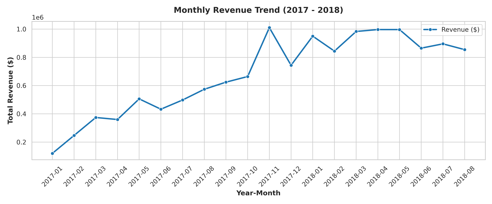
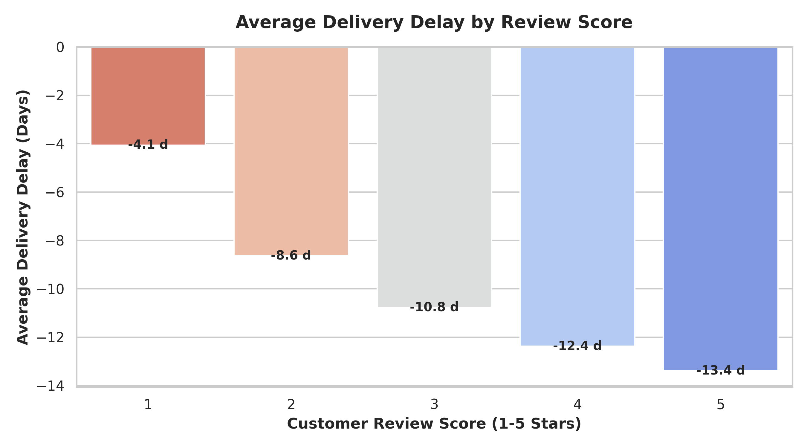
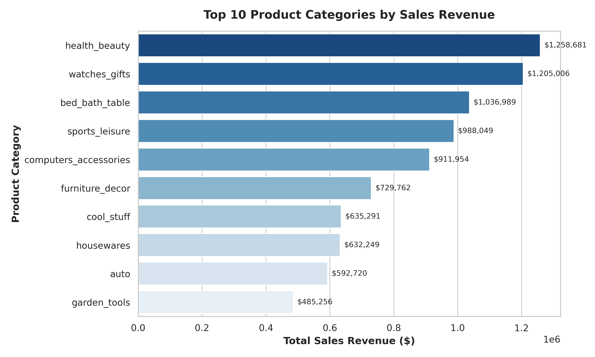
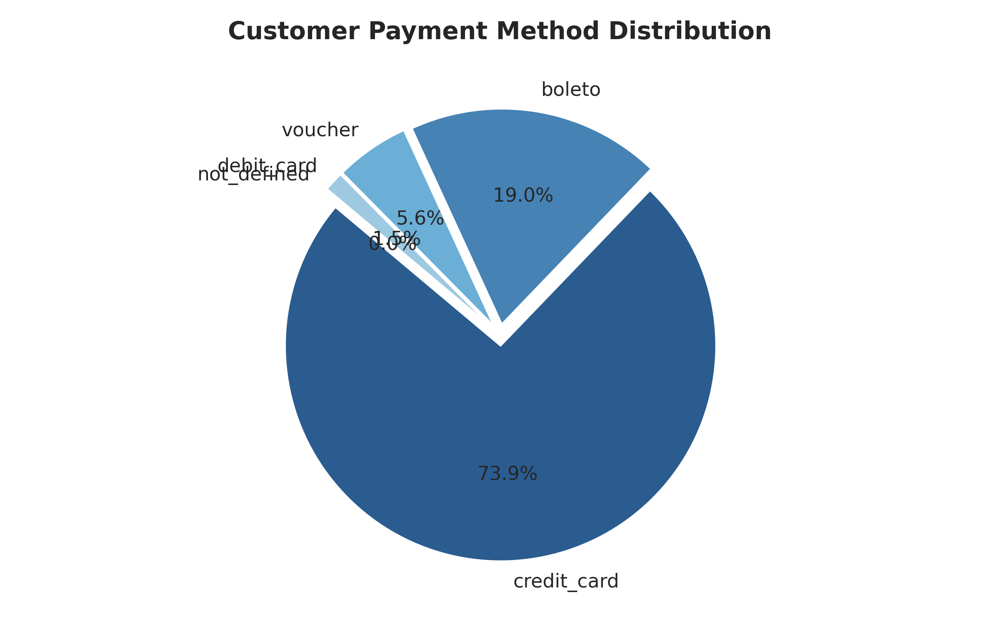
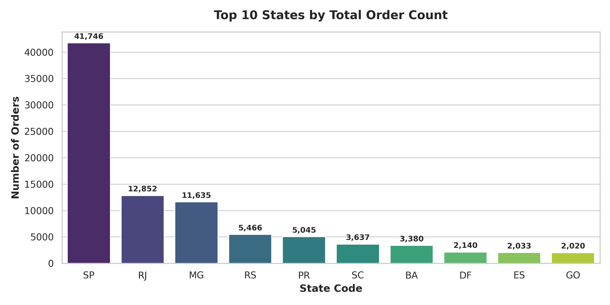

# 🛒 Retail Business Intelligence — E-Commerce Analytics Pipeline


An **end-to-end business intelligence pipeline** built on the **Olist Brazilian E-Commerce Dataset** (99,441 orders spanning 2016–2018). This project covers the full analytics workflow: from data quality assessment and feature engineering in **Python**, through relational data modeling and advanced SQL queries (**CTEs, Window Functions, Cohort Analysis**), to interactive dashboarding in **Power BI**.

---

## 🎯 Business Context & Objectives

E-commerce marketplaces face complex operational challenges across customer satisfaction, fulfillment logistics, and revenue growth. This project addresses critical executive questions:

1. **Growth Trends**: What is the trajectory of revenue growth, and how do seasonal events (e.g., Black Friday) impact sales?
2. **Logistics Bottlenecks**: How do shipping delays correlate with low customer review scores (1-star ratings)?
3. **Category Strategy**: Which product categories drive high gross revenue versus high unit volume?
4. **Financial Behavior**: How do customers utilize installment financing across payment options?

---

## 📊 Executive KPI Summary

| Metric | Value | Business Context |
|---|---|---|
| **Gross Revenue** | **$13,591,643.70** | Total sales value generated across delivered orders |
| **Total Orders** | **99,441** | Placed transactions from 2016 to 2018 |
| **Average Order Value (AOV)** | **$136.68** | Mean revenue per order |
| **Fulfillment Rate** | **97.0%** | Delivered order status completion rate |
| **Late Delivery Rate** | **6.8%** | Orders arriving past the estimated promised date |
| **Average Review Rating** | **4.09 / 5.0** | Customer satisfaction score across 99K+ reviews |

---

## 📈 Key Insights & Visualizations

### 1. Monthly Revenue Growth & Seasonality
Revenue expanded rapidly through 2017, rising from **$120K/month** in early 2017 to over **$1.0M/month** in 2018. November 2017 recorded a sharp revenue peak driven by Black Friday promotions.



### 2. Logistics Delay vs Customer Satisfaction
Fulfillment speed is the **#1 driver of customer sentiment**. All delivered orders arrived before the estimated date on average, but the margin varies dramatically by satisfaction level:
- **1-Star reviews**: Smallest early delivery margin — only **4.1 days ahead** of the estimated date.
- **5-Star reviews**: Arrived **13.4 days ahead** of the estimated date — over 3× the buffer of 1-star orders.
- **Key insight**: Customers who received their orders closest to (or past) the promised date were significantly more likely to leave negative reviews.



### 3. Merchandising Performance (Top Product Categories)
- **Revenue Leaders**: `health_beauty` ($1.25M) and `watches_gifts` ($1.20M) generated the highest gross revenue.
- **Volume Leaders**: `bed_bath_table` led total unit volume sold.



### 4. Payment Method Preferences
- **73.9%** of purchases are completed via Credit Card, followed by **Boleto (19.0%)**.
- Over 50% of credit card users opt for **3+ installment payments**, showing high reliance on credit financing.



### 5. Geographic Order Distribution
Order volume is heavily concentrated in southeastern Brazil:
- **São Paulo (SP)** dominates with **41,746 orders** (42% of total), followed by **Rio de Janeiro (RJ)** at 12,852 and **Minas Gerais (MG)** at 11,635.
- The top 3 states account for nearly **67% of all orders**, indicating significant geographic concentration.



### 6. Power BI Dashboard — Custom Visualization
A comprehensive executive dashboard was built in Power BI with interactive slicers, KPI cards, and drill-through visuals. View the full exported dashboard visualization:

📄 [View Dashboard Export (PDF)](powerbi/visualisation1.pdf)

---

## 🗄️ Database Schema & Data Modeling

The relational database architecture is structured around 9 interconnected tables:

```
                  ┌───────────────┐
                  │   CUSTOMERS   │
                  └───────┬───────┘
                          │ 1
                          │
                          │ N
                  ┌───────┴───────┐
                  │    ORDERS     ├──────────────┬──────────────┐
                  └───────┬───────┘              │              │
                          │ 1                    │ 1            │ 1
                          │                      │              │
                          │ N                    │ N            │ N
                  ┌───────┴───────┐      ┌───────┴──────┐┌──────┴───────┐
                  │  ORDER_ITEMS  │      │   PAYMENTS   ││   REVIEWS    │
                  └───────┬───────┘      └──────────────┘└──────────────┘
                          │ N
            ┌─────────────┴─────────────┐
            │ 1                         │ 1
    ┌───────┴───────┐           ┌───────┴───────┐
    │   PRODUCTS    │           │    SELLERS    │
    └───────────────┘           └───────────────┘
```

For complete field schemas and data types, refer to the [docs/data_dictionary.md](docs/data_dictionary.md).

---

## ⚡ Advanced SQL Analytics (SQL Highlights)

The repository includes [sql/SQL_ANALYSIS.sql](sql/SQL_ANALYSIS.sql) featuring 25+ queries, including advanced CTEs and Window Functions:

### 1. Month-over-Month (MoM) Growth Rate (`LAG` Window Function)
```sql
WITH monthly_rev AS (
    SELECT order_year, order_month, ROUND(SUM(order_value), 2) AS monthly_revenue
    FROM orders WHERE order_status = 'delivered'
    GROUP BY order_year, order_month
)
SELECT order_year, order_month, monthly_revenue,
       LAG(monthly_revenue) OVER (ORDER BY order_year, order_month) AS prev_month,
       ROUND(100.0 * (monthly_revenue - LAG(monthly_revenue) OVER (ORDER BY order_year, order_month))
             / NULLIF(LAG(monthly_revenue) OVER (ORDER BY order_year, order_month), 0), 2) AS mom_growth_pct
FROM monthly_rev;
```

### 2. Seller Ranking by State (`RANK() OVER (PARTITION BY)`)
```sql
WITH seller_rev AS (
    SELECT s.seller_state, s.seller_id, ROUND(SUM(oi.price), 2) AS total_revenue
    FROM sellers s JOIN order_items oi ON s.seller_id = oi.seller_id
    GROUP BY s.seller_state, s.seller_id
)
SELECT seller_state, seller_id, total_revenue,
       RANK() OVER (PARTITION BY seller_state ORDER BY total_revenue DESC) AS rank_in_state
FROM seller_rev;
```

---

## 📊 Power BI Dashboard Preview

An interactive executive dashboard was built in **Power BI Desktop** using the cleaned dataset with a **Star Schema data model**. The `.pbix` file is available at [powerbi/visualisation.pbix](powerbi/visualisation.pbix).

**Dashboard Features:**
- 📌 **KPI Cards**: Gross Revenue, Total Orders, AOV, Avg Review Score, Late Delivery Rate
- 📈 **Line Chart**: Monthly Revenue & Order Volume trend over time
- 📊 **Bar Charts**: Top Product Categories by Revenue, Delivery Delay vs Review Score
- 🍩 **Donut Chart**: Payment Method Breakdown
- 🔍 **Slicers**: Year, Order Status, State/Region filters

📄 **Dashboard Export**: [View Full Dashboard (PDF)](powerbi/visualisation1.pdf)

---

## 📐 Power BI DAX Modeling & Measures

The project includes a comprehensive **DAX Measure Library** in [powerbi/DAX_MEASURES.md](powerbi/DAX_MEASURES.md) featuring 17+ DAX expressions for Power BI Desktop:

- **Time Intelligence**: `YoY Revenue Growth Pct`, `MoM Revenue Growth Pct`, `Cumulative Revenue YTD` (`TOTALYTD`)
- **Fulfillment KPIs**: `Late Delivery Pct`, `Fulfillment Rate Pct`, `Avg Delivery Days`
- **Customer Metrics**: `1-Star Review Pct`, `5-Star Review Pct`, `Repeat Customer Rate`

Example DAX Measure:
```dax
YoY Revenue Growth Pct = 
VAR CurrentRevenue = [Total Revenue]
VAR PreviousYearRevenue = CALCULATE([Total Revenue], SAMEPERIODLASTYEAR(Dim_Calendar[Date]))
RETURN DIVIDE(CurrentRevenue - PreviousYearRevenue, PreviousYearRevenue, 0)
```

---

## 📂 Project Structure

```
retail-business-intelligence/
├── README.md                           ← Executive Summary & Visual Overview
├── LICENSE                             ← MIT License
├── .gitignore                          ← Excludes heavy CSV datasets from Git
├── requirements.txt                    ← Python library dependencies
├── docs/
│   ├── data_dictionary.md              ← Relational schema & column definitions
│   └── data_quality_report.csv         ← Data audit summary metrics
├── images/                             ← Exported visualization charts
│   ├── monthly_revenue_trend.png
│   ├── delivery_vs_review_score.png
│   ├── top_product_categories.png
│   ├── payment_methods_distribution.png
│   └── top_states_orders.png           ← Geographic order distribution
├── notebooks/
│   ├── 01_data_quality_assessment.ipynb ← Data auditing & cleaning pipeline
│   └── 02_exploratory_data_analysis.ipynb← EDA with Seaborn charts & insights
├── powerbi/
│   ├── visualisation.pbix              ← Interactive Power BI Dashboard
│   ├── visualisation1.pdf              ← Dashboard export (PDF)
│   └── DAX_MEASURES.md                 ← 17+ DAX Formulas & Star Schema Specs
└── sql/
    └── SQL_ANALYSIS.sql                ← DDL Schemas + 25 SQL Analysis Queries
```

---

## 🚀 Getting Started & Reproduction

### Prerequisites
- Python 3.9+
- Jupyter Notebook / VS Code
- PostgreSQL (or any SQL RDBMS)
- Power BI Desktop (to view `.pbix`)

### Setup Instructions

1. **Clone the repository**:
   ```bash
   git clone https://github.com/your-username/retail-business-intelligence.git
   cd retail-business-intelligence
   ```

2. **Install dependencies**:
   ```bash
   pip install -r requirements.txt
   ```

3. **Download Dataset**:
   - Download the raw CSVs from [Kaggle Olist E-Commerce Dataset](https://www.kaggle.com/datasets/olistbr/brazilian-ecommerce).
   - Place raw CSV files into `data/` folder.

4. **Run Cleaning & EDA Notebooks**:
   ```bash
   jupyter notebook notebooks/02_exploratory_data_analysis.ipynb
   ```

5. **Run SQL Analysis**:
   - Import dataset tables into PostgreSQL and run `sql/SQL_ANALYSIS.sql`.

---

## 👔 Resume Showcase Highlights

If showcasing this project on your CV / Resume:

- **End-to-End Business Intelligence Pipeline**: Designed a multi-layered ETL and analytics pipeline analyzing **100K+ e-commerce transactions** across 9 relational tables using **Python, SQL, and Power BI**.
- **Data Quality & Feature Engineering**: Cleaned **261K duplicate records** and engineered key operational metrics (`delivery_delay`, `AOV`, time-based variables).
- **Advanced SQL Querying**: Authored **25+ SQL scripts** utilizing **CTEs, window functions (`LAG`, `RANK`), and cohort analysis** to quantify the revenue impact of delivery delays.
- **Data Visualization & Insights**: Produced executive dashboarding and visualizations demonstrating that delivery delays past promised estimates correlate directly with **1-Star review ratings**.
